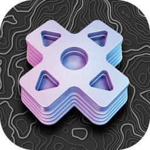
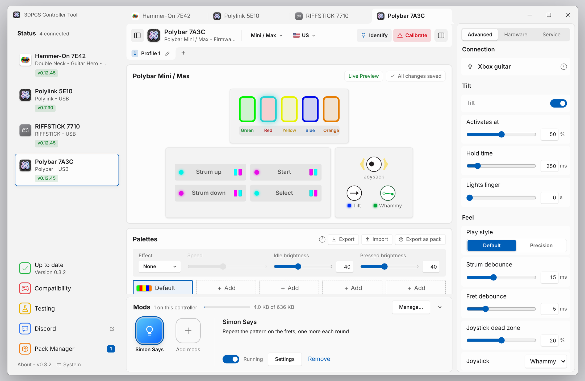

# 3DPCS Controller Tool

**Set up, update and customize your 3DPCS controller**

 

&nbsp;

&nbsp;

Questions or need a hand? Ask us on Discord

 

<picture>
  <source media="(prefers-color-scheme: dark)" srcset=".github/assets/tool-dark.png">
  
</picture>

## Getting started

1. **Download** the app for your computer from the latest release.
2. **Plug in** your controller with a USB cable.
3. **Open the app.** It finds your controller, offers any update, and shows every button as you press it.
4. **Make it yours**: calibrate, pick your colors and add mods. Your settings are saved on the controller, so they go wherever it goes.

## First time opening it

- **Windows:** if you see "Windows protected your PC", click **More info**, then **Run anyway**.
- **Mac:** open the `.dmg` and drag the app to Applications. The first time, right-click the app and choose **Open**.
- **Linux:** right-click the file, choose **Properties**, turn on **Allow executing as a program**, then double-click it.
- **App signing:** we're setting up signing for Windows and Mac. Once it's in place, these warnings go away.

## About

The 3DPCS Controller Tool and its firmware are written by 3D Printed Controller Systems and aren't based on any other configurator. They use a few standard open-source parts (Tauri, Svelte, the Raspberry Pi Pico SDK, TinyUSB, BTstack and Pico-PIO-USB for USB port access), listed in [THIRD_PARTY_NOTICES.txt](THIRD_PARTY_NOTICES.txt).

For personal, non-commercial use, provided as is. Full terms: [LICENSE.md](LICENSE.md).

## Where to get a controller

Shops whose controllers work with the 3DPCS Controller Tool:

<table>
<tr>
<td align="center" width="25%"><a href="https://threepieces.net/"><b>Three Pieces</b></a> 🇺🇸</td>
<td align="center" width="25%"><a href="https://layerstack.us/"><b>Layer Stack</b></a> 🇺🇸</td>
<td align="center" width="25%"><a href="https://foucaultcustoms.com.br/"><b>Foucault Customs</b></a> 🇧🇷</td>
<td align="center" width="25%"><a href="https://rknz.nz/"><b>RKNZ</b></a> 🇳🇿 🇦🇺</td>
</tr>
<tr>
<td align="center" width="25%"><a href="https://tripledee.co.uk/"><b>Triple Dee</b></a> 🇬🇧 🇪🇺</td>
<td align="center" width="25%"><a href="https://www.phunkycustoms.com/"><b>Phunky Customs</b></a> 🇺🇸</td>
<td align="center" width="25%"><a href="https://lovettcustoms.com/"><b>Lovett Customs</b></a> 🇺🇸</td>
<td align="center" width="25%"><a href="https://www.hammeronguitars.com/"><b>Hammer-On Guitars</b></a> 🇺🇸</td>
</tr>
</table>

© 2026 3D Printed Controller Systems

