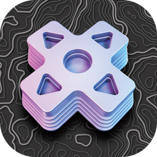
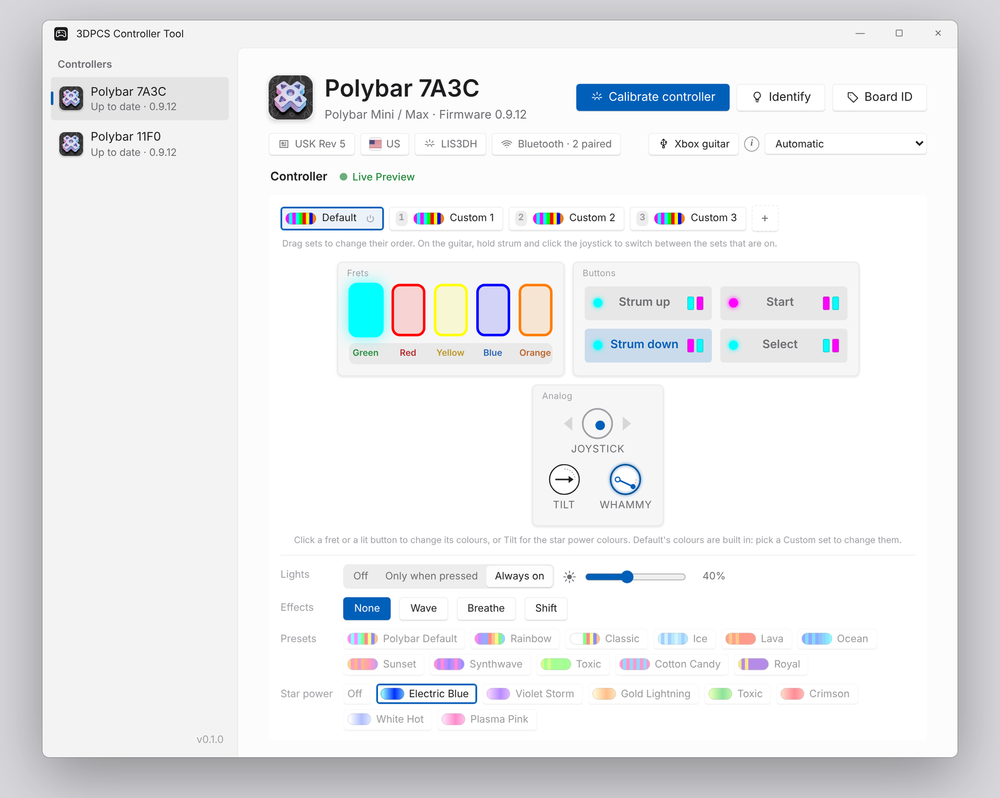
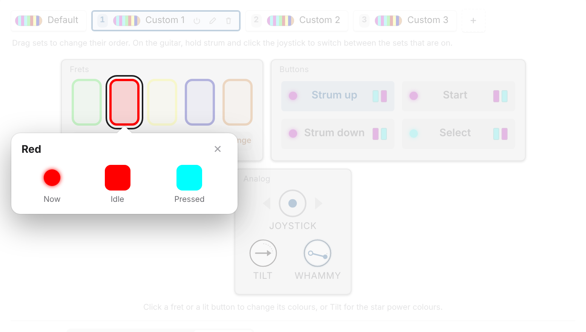
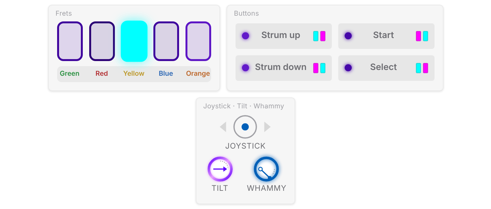

# 3DPCS Controller Tool

**Set up, update and customize your Polybar guitar controller.** 
Windows · Mac · Linux. Nothing to install.

 

&nbsp;

&nbsp;

 

<picture>
  <source media="(prefers-color-scheme: dark)" srcset=".github/assets/app-dark.png">
  
</picture>

## Four steps

1. **Download** the one file for your computer (buttons above).
2. **Plug in** your Polybar with a USB cable.
3. **Configure**: open the tool. It finds your controller, updates it if needed, and shows every button, the joystick, tilt and whammy live. Calibrate tilt and whammy and pick your light colors.
4. **Play**: Clone Hero, YARG and other rhythm games.

That's it. Your settings live on the controller, so they go wherever it goes.

## Make it yours

- **Color sets:** up to five of your own, with names (Set 1 starts with the Polybar colors, and every set is editable). Click any fret or button to pick its idle and pressed color, add an effect (Wave, Breathe, Shift), set the brightness, or start from a preset like Synthwave or Cotton Candy. Switch sets right on the guitar: hold strum and click the joystick.
- **Star power lights:** tilt the neck and your lights fade into crackling electric waves. Electric Blue, Violet Storm, Gold Lightning, Toxic, Crimson, White Hot or Plasma Pink, picked per color set.
- **Plays the way you hold it:** right- or left-handed is detected on its own. Fast strumming won't set off star power by accident, and a full whammy push always reads as full.

<table><tr>
<td width="50%"><picture><source media="(prefers-color-scheme: dark)" srcset=".github/assets/colors-dark.png"></picture> Click a fret: see its color now, idle and pressed.</td>
<td width="50%"><picture><source media="(prefers-color-scheme: dark)" srcset=".github/assets/star-dark.png"></picture> Star power on, in Violet Storm.</td>
</tr></table>

## First time opening it

Your computer may double-check the app the first time:

- **Windows:** if you see *"Windows protected your PC"*, click **More info**, then **Run anyway**.
- **Mac:** open the `.dmg` and drag the app to Applications. The first time, **right-click** the app and choose **Open**.
- **Linux:** right-click the file, then **Properties → Permissions → Allow executing as a program**. Then double-click it.

## Wireless

Controllers with wireless built in play over Bluetooth whenever they're unplugged. Pair it once from your computer's Bluetooth settings: it shows up with the name you gave it in the tool. Plug the cable back in and it switches to USB on its own.

## Need help?

- Join the [Discord](https://discord.gg/2RZSukqS6Y): we're happy to help with setup, builds and anything else.
- Controllers, solderless kits and parts: [threepieces.net](https://threepieces.net/)
- Build your own: [Polybar System on Printables](https://www.printables.com/model/277183-polybar-system-3d-printed-guitar-controllers)

## Free, and our own code

The 3DPCS Controller Tool and the firmware it installs are **free**. We don't charge for them. If someone sold you
this app, you can download it free from this page.

Everything that makes the tool and our firmware work is written by 3D Printed Controller Systems. It is closed source
and not based on any other configurator. Like almost all software, it is built on a few standard
open-source building blocks (Tauri, Svelte, the Raspberry Pi Pico SDK, TinyUSB, Bluetooth, and Pico-PIO-USB for the
Polylink's USB port). Their licences let them be
used in closed-source products and only ask that we list them: see
[THIRD_PARTY_NOTICES.txt](THIRD_PARTY_NOTICES.txt), also in the app under **About › Licences**.

## License

Free for personal, non-commercial use with our controllers and kits. The tool and firmware are proprietary: no
copying, reverse engineering or reuse in other configurators. Full terms: [LICENSE.md](LICENSE.md).

 

© 2026 3D Printed Controller Systems · Three Pieces Controllers

